# NIA Standalone: complete system flowchart

This review describes the first-party runtime in `frontend/`, `backend/app/`,
`services/whisper/`, `voice_cli.py`, and `infra/`. Tests, benchmark drivers,
database-review notebooks, generated caches, and reference repositories are not
runtime blocks.

Planner routing: `PLANNER_MODE=ai` (default, Phase 2) is the active flow in
section 4. The 15-gate tree in section 4.1 is the `PLANNER_MODE=legacy`
emergency rollback path and is unchanged until Phase 3.

Legend:

- Solid arrow: active runtime call or data flow.
- Dashed arrow: configuration, fallback, optional provider, or operational path.
- PostgreSQL access from the assistant runtime is intended to pass through
  `assistant_api` views/functions or assistant-owned tables.

## 1. Whole-system context

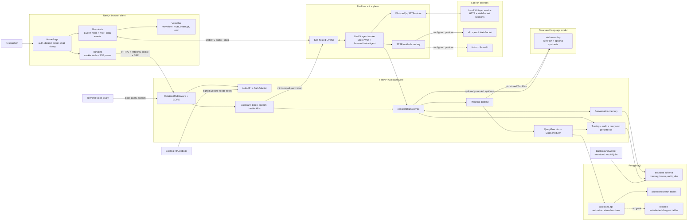

## 2. Authentication and authorization flow

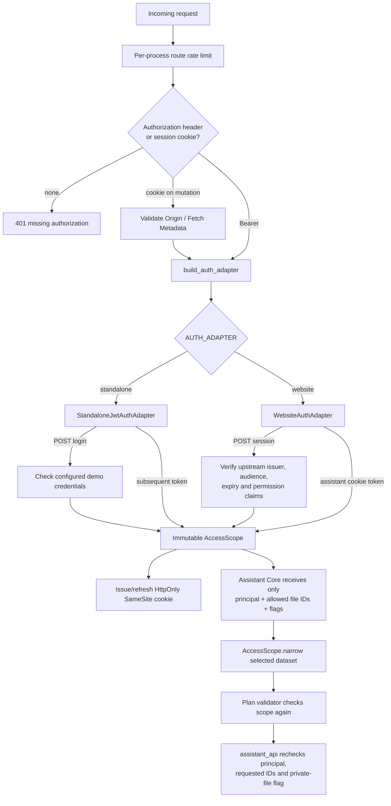

The two authentication modes replace only the identity source. Planning,
execution, memory, voice, STT, TTS, reasoning, and citations consume the same
`AccessScope` type.

## 3. Text query flow

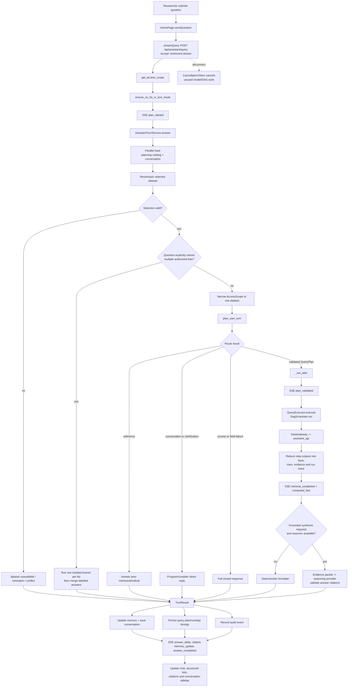

## 4. Ordered planning decision tree

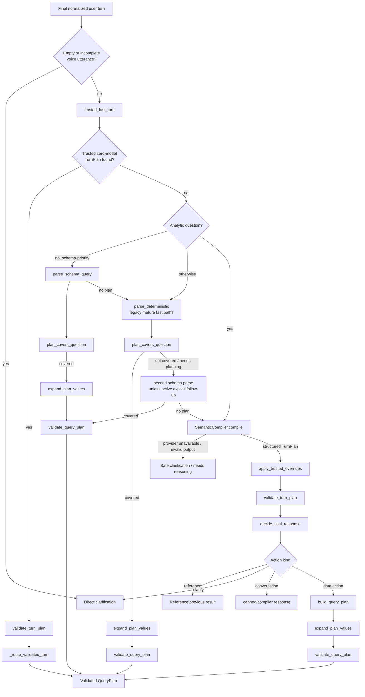

### 4.0 Active AI planner flow (`PLANNER_MODE=ai`)

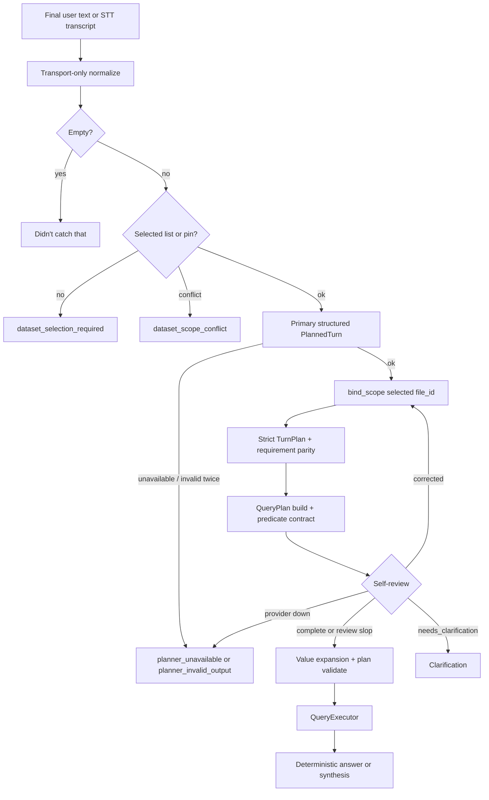

Dataset scope is the UI selection or conversation pin only. The model never
emits file IDs. Other authorized list names may appear as `dataset_not_selected`.

### 4.1 Legacy 15-gate tree (`PLANNER_MODE=legacy` rollback)

The planner is called only for a final text message or final STT transcript. Partial
voice hypotheses are display-only and cannot start planning.

| Order | Gate | Rule and outcome |
|---:|---|---|
| 1 | Input normalization | Apply Unicode NFKC; normalize quotes/non-breaking spaces; resolve only one-token letter/year self-corrections; remove speech fillers and a small set of polite wrappers; collapse punctuation and whitespace. The normalizer never paraphrases. Remaining correction markers make the deterministic parser abstain. |
| 2 | Empty/incomplete guard | Empty input returns “didn’t catch that.” Voice text ending like an unfinished fragment returns a clarification before any model or database call. |
| 3 | Scope/context construction | Restrict the field catalog to `AccessScope`; attach active query, topic frames, last action keys, recent memory, user display name, and previous assistant text. |
| 4 | Trusted fast turn | Try only high-confidence program rules. Cause-of-death summaries deliberately bypass this gate so they retain evidence and synthesis. Query fast exits are limited to bounded random samples, a pure “list students” request, and an unambiguous named-person follow-up. |
| 5 | Analytic guard classification | Percentage, superlative/ranking, statistics, duplicate, distinct, “each/per,” and missing-bucket shapes skip legacy deterministic/schema shortcuts that could collapse them into a count or arbitrary row page. |
| 6 | Schema-priority parse | For a non-analytic schema-priority question, try the catalog-driven parser before the legacy grammar. Accept only an unambiguous operation, field, and value and only when `plan_covers_question` succeeds. |
| 7 | Legacy deterministic parse | For non-analytic turns, try the mature zero-model grammar and conversation-follow-up resolver. It requires complete semantic coverage (`min_coverage=1.0`) and otherwise abstains. |
| 8 | Second schema parse | If the legacy result is `needs_planning`, try the schema parser unless this is an active-query follow-up with explicit cues such as next, previous, same, also, add, those, or each one. |
| 9 | Semantic compiler | Send the scoped catalog and conversation state to the structured provider, requesting a typed `TurnPlan`. Malformed provider output is retried once. Provider failure returns a safe clarification; it never falls through to raw SQL or an unvalidated answer. |
| 10 | Trusted post-compiler overrides | Correct high-confidence conversational, paging, projection, sample, reference, and analytic shapes in the typed output. Dataset/filter choices remain subject to validation. |
| 11 | Turn validation | Enforce action, confidence, scope, field, operator, aggregate, evidence, follow-up, and injection rules. |
| 12 | Response route | Reference actions read prior results; clarification/conversation actions return program-owned text; data actions continue to deterministic query-plan construction. |
| 13 | Query-plan build | Convert effective query actions into one or more independent DAG branches. Model output is not executable and never supplies SQL. |
| 14 | Value expansion | Clean filter articles/punctuation, correct a value assigned to the wrong semantic field when ownership is unique, expand field-registry synonym families, and exclude literal unknown labels for `IS_KNOWN`. |
| 15 | Query-plan validation | Enforce injection, budgets, scope, DAG, operation contracts, feature gates, catalog capabilities, sorting, and evidence sensitivity. Only success reaches `QueryExecutor`. |

### 4.2 Trusted fast-path and post-compiler override flow

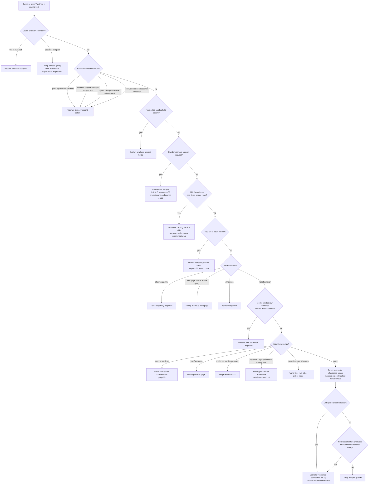

Trusted-rule details:

- A bare “yes/okay” becomes a voice action only after a voice offer, becomes next
  page only after a page offer with active state, and otherwise stays an
  acknowledgement.
- “What?” or confusion is not treated as a row reference. A row reference requires
  an explicit ordinal/index such as first, second, fifth, last, or an index 0–49.
- A new non-page request resets an accidental previous offset. Sampling clears
  offset, result window, and sorting.
- “All information” expands only to public fields on the already scoped dataset;
  it cannot pull fields from another list.
- Trusted replacements set confidence to at least 0.95 and deterministic response
  mode, but are still passed through `validate_turn_plan` and `validate_query_plan`.

### 4.3 Analytic correction rules

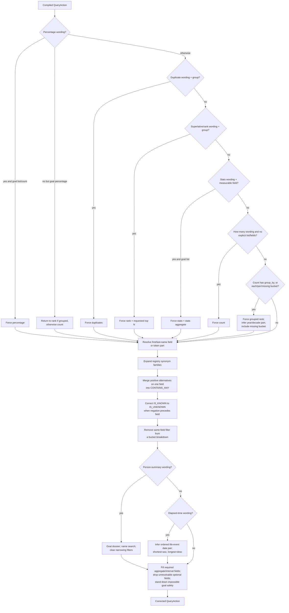

Analytic guards are application-owned corrections; they do not trust the model’s
chosen calculation shape. Their main invariants are:

- A calculation is never replaced by an arbitrary page of records.
- Multiple positive terms for one field are alternatives (`CONTAINS_ANY`), not an
  impossible AND of several `CONTAINS` filters.
- Historical spelling families come from field-registry `value_synonyms`, including
  correct negative-family operators.
- “No/missing/without field” is `IS_UNKNOWN`; “known/recorded field” is
  `IS_KNOWN`, with literal “Unknown” spellings excluded later.
- A grouped breakdown includes missing values only when asked and removes a filter
  on the same field so all requested buckets survive.
- Life-event intervals are ordered birth → admission → discharge → death → burial →
  registration regardless of the order in which events appear in the sentence.

### 4.4 Complete semantic compiler rule contract

The structured compiler is instructed with the following complete rule groups.
Application validation and trusted overrides remain authoritative if model output
conflicts with them.

| Prompt rules | Complete requirements |
|---|---|
| 1–5: safety and grounding | Never generate SQL; never invent datasets/fields; use only the authorized catalog; database facts require query actions; research facts cannot appear in respond actions. |
| 6–14: response and context | General conversation may respond; exact calculations are deterministic; interpretation/synthesis/judgment/narrative evidence uses LLM synthesis; preserve self-corrections; resolve confident follow-ups from active query; clarify only genuine ambiguity; preserve independent requests as independent actions; do not reveal inaccessible datasets; do not guess field meanings. |
| 15–16c: conversational intents | Identity, audio, greetings, thanks, farewells, capability, available-data, acknowledgements, user identity/introduction, corrections, and general conversation use their typed intents. “I am X” is user introduction; “who am I” is user identity; “who are you” is assistant identity. Non-research/general-knowledge work is general conversation with no query. References require explicit row/action ordinals and cannot invent a prior record. |
| 17–19: action structure | Independent requests remain separate query actions; unrelated filters are never ANDed together. Compare needs at least two branches; aggregate needs an aggregate spec; list plus `group_by` means presentation grouping. Clarify only when different interpretations would produce different queries, not merely because a question is hard. |
| 20–25: list/follow-up behavior | “List all/them/one by one” is exhaustive list, normally numbered. Pages default to 25 and max at 50; “all” is paginated. Next/show more modifies the previous list. “List them” after a count changes the goal to list. Challenges create `verify_previous`. Organized/alphabetical/one-by-one changes presentation/sort without losing dataset/filters. |
| 26–30: windows, projection, sampling | First/last N is a start/end result window with cursor 0 and page `min(N,50)`, never a remembered absolute offset. Adding fields beside prior rows modifies `requested_fields` while preserving filters/sort/window. New multi-field lists use table presentation. Random/sample is bounded sampling, not paging. Requiring admitted and discharged dates produces two `IS_KNOWN` filters and projects both fields. |
| 31–32: count/percentage | “How many/total” → count. “Percentage/proportion/share” → percentage, with subset filters in numerator and population filters in `denominator_filters`; empty denominator means the whole scoped dataset. |
| 33–34: rank/distinct | Most/fewest/top/rank/common/frequent → rank with the ranked field in `group_by` and requested `top_n`. Values listed/recorded/different/unique → distinct with that field in `group_by`. |
| 35–39: analytic goals | Youngest/oldest/average/median/how old → stats over a numeric/date field. Repeated/shared values → duplicates with group and optional companion field. Duration wording → interval with two date fields and asc/desc direction for shortest/longest. Most/least complete record → completeness. “Everything about person” → dossier + name search + LLM synthesis. |
| 40: time buckets | Per-year/per-decade grouping uses the corresponding value part on a date. A superlative inside each outer bucket uses outer group first and `per_group_top_n=1`. |
| 41–46: filters | Independent conditions are AND unless true either/or. Synonym families use `CONTAINS_ANY`; negatives use `NOT_CONTAINS_ANY`. “Other than” is a negative comparison, not missingness. Missing/without → `IS_UNKNOWN`; known/recorded → `IS_KNOWN`; known fields with literal Unknown also exclude that label. Preserve every stated condition. First/last/full names map to their catalog fields or name token parts. |
| 47–49: answer shape | Calculations must use their computation goal. “Who/which, all” uses exhaustive list with named fields. Counts, rankings, statistics, percentages, distinct values, duplicates, and intervals are deterministic; dossiers and genuinely interpretive questions use synthesis. |

The compiler request contains only: current utterance and mode; recent conversation;
active query; topic frames; last action keys; display name; scoped datasets and
field metadata; allowed operators; field types/capabilities; and registry synonym
families. It receives no SQL schema or direct database connection.

### 4.5 Deterministic and schema-parser acceptance rules

| Parser | Accepts | Mandatory abstention rules |
|---|---|---|
| Legacy deterministic parser | Explicit count/list; authorized dataset resolution; high-confidence name-prefix, community, year/date-event, deceased-state, distinct-field, bounded-list, and mature conversation-follow-up shapes. | Abstain for unresolved corrections, pronoun/referential follow-ups needing semantics, synthesis/explanation, typed aggregates, comparison/ratio/percentage/rank, negation/complex clauses, multiple actions, missing context, unsupported constraints, or any semantic content not fully consumed. |
| Schema-driven parser | A single selected dataset with an unambiguous catalog operation and field: count, distinct, distribution/mode, min/max, list, field presence/missingness, starts/contains, numeric/date values/ranges, named person, bounded sort/window. | Abstain for schema-description questions, random/sample, summary/why/explain, quote/provenance, each/per, organize, compare/versus/exclude, huge first/last windows, compound count-and-list, absent/ambiguous field, unresolved required predicate, or no explicit supported goal. |
| Coverage checker | Every content word must be query language, catalog vocabulary, or represented in the plan; every specifically named catalog field must be referenced by a field, predicate, sort, interval, or companion slot. | Any leftover value/field (for example a disease term not represented in predicates) rejects the fast plan and sends the turn to semantic compilation. |

### 4.6 Turn validation flow and rules

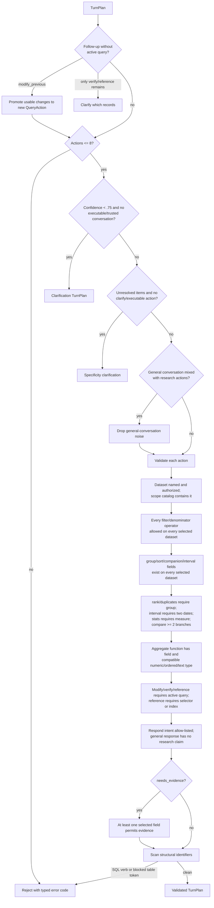

Turn validation scans structural identifiers, not user free text. A user may search
for words that resemble SQL; only action types, semantic field identifiers, group/
sort/aggregate fields, compare filters, and intent identifiers are protected from
SQL/table-name injection.

### 4.7 QueryPlan compilation rules and goal-to-DAG map

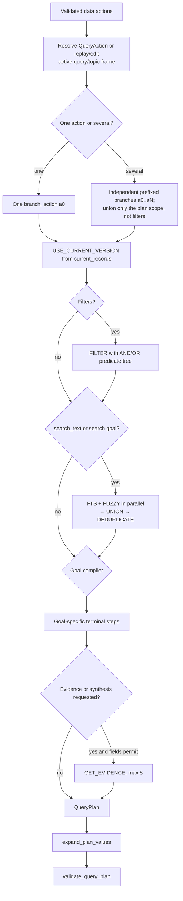

| Effective goal | Compiled DAG behavior |
|---|---|
| `count` | Optional filter/retrieval, optional per-dataset grouping for an unfiltered multi-file count, then `COUNT`; optional evidence. |
| `list` | Optional filter/retrieval, deterministic `SORT`, total `COUNT`, `SAMPLE` or bounded `LIMIT`, then catalog-approved `PROJECT`; optional evidence. |
| `search` | FTS + fuzzy branches → union → deduplicate → bounded projection and evidence. |
| `distinct` | `GROUP_BY` over one/two canonical fields with value-part, missing, having, top-N, and per-group controls. |
| `rank` | `RANK` over one/two group fields with optional top-N/per-group top-N and missing bucket. |
| `stats` | `STATS` over a resolved measure; optional parallel grouped `RANK`. |
| `aggregate` | Optional grouping followed by `COUNT`, `COUNT_DISTINCT`, `SUM`, `AVG`, `MIN`, or `MAX`. Median/mode/stats compile to the single `STATS` pass. |
| `percentage` | Independent numerator and denominator sources/counts, then `PERCENTAGE`; denominator filters define the population. |
| `compare` | At least two independent filter/search/count branches, then `COMPARE`. |
| `duplicates` | `DUPLICATES` on the group field with minimum count (default 2), optional companion, value part, and top N. |
| `interval` | `INTERVAL_STATS` using ordered start/end fields, bounds, direction, and a display-row limit. |
| `completeness` | `COMPLETENESS`, direction asc/desc, capped at 50 rows. |
| `quote` | `GET_QUOTE`, at most 8 rows, using quoteable evidence fields. |
| `provenance` | `GET_PROVENANCE`, default 20 and capped at 50. |
| `dossier` | Name retrieval → project every public field common to scope → evidence packet → synthesis goal. |
| `verify_previous` | Replay prior datasets/filters/search/fields as an exhaustive first page, clear prior result window, sort deterministically, and mark verification for the answer preface. |
| `modify_previous` | Preserve active query; upsert changed filters by field; apply page/window cursor, goal, limit, fields, sample, sort, presentation, or frame restoration without widening datasets. |

Bounded-output rules:

- Default list page: 25; maximum normal page/sample: 50.
- Explicit exhaustive enumeration ceiling: 200, still paginated in normal UI flow.
- Result-window size: 1–5000; page inside the window remains at most 50.
- Evidence/quote rows: at most 8.
- `group_by`: at most two fields; `per_group_top_n`: at most 50; general `top_n`:
  at most 500.

### 4.8 Final QueryPlan validation flow and rules

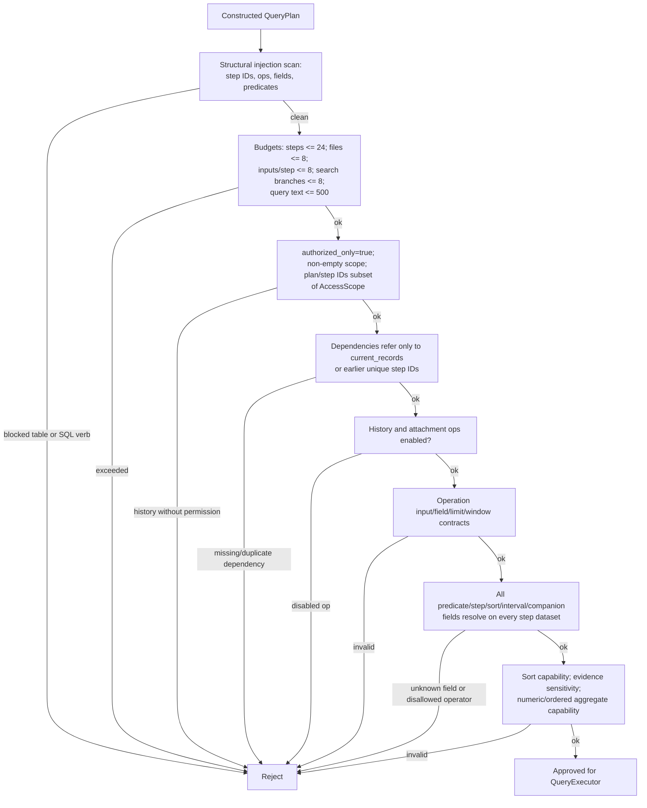

Operation contracts enforced at this layer include:

- Single-input operations must have exactly one dependency; union/intersection/
  difference/compare/ratio/percentage require at least two.
- `FILTER` needs predicates; `COUNT_DISTINCT`, `STATS`, and `DUPLICATES` need
  exactly one field; numeric aggregates need one numeric/ordered field.
- `SORT` needs a sortable field; `LIMIT`, `TOP_N`, and `SAMPLE` need a limit.
- Result-window anchor and size must appear together and only on `LIMIT`/`PROJECT`.
- `RANK` needs one or two group fields; intervals need both start and end fields.
- History is off by default and also requires `AccessScope.history_allowed`;
  attachment content is off by default.

### 4.9 Final response-policy rules

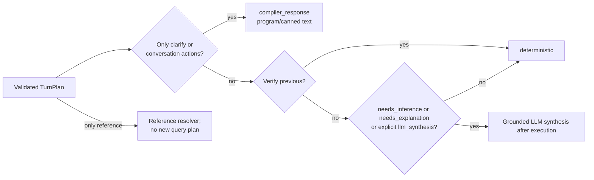

Even when synthesis is selected, the deterministic plan executes first and builds a
bounded evidence packet. Synthesis output is accepted only after citation validation;
visible/stored answers cannot cite a source outside that packet.

Security invariants in the planning path:

- Model output is a typed `TurnPlan`; application code builds the `QueryPlan`.
- Both turn and query plans reject structural injection and unauthorized datasets.
- Fields, operators, aggregate capability, budgets, DAG dependencies, history use,
  and attachment use are validated against the scoped field catalog.
- The model never emits SQL and the runtime database role cannot read the blocked
  website tables.

## 5. Query execution, operations, and retrieval

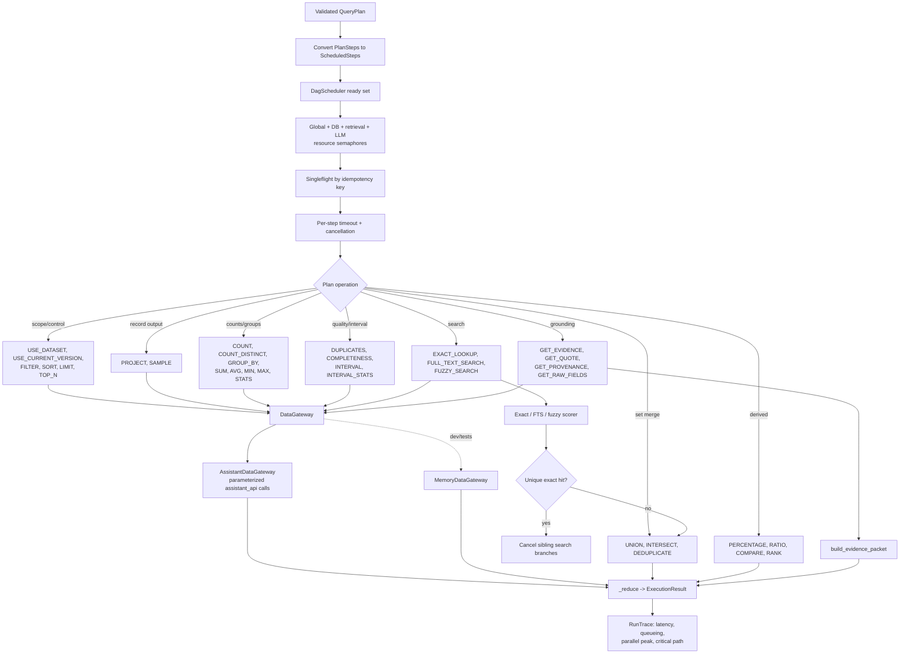

Declared `PlanOp` values that are not accepted by the current deterministic
executor/validator are reserved or handled earlier in planning: history-version,
previous-result/topic-frame resolution, alias/reference/entity/pronoun/ordinal
resolution, semantic search/classification, active-query edits, difference/exclude,
normalization, conflict checks, and approved attachments.

`HybridRetriever` is implemented and tested as a standalone exact/FTS/fuzzy
fan-out with entity resolution, deduplication, ranking, and early cancellation.
The active `QueryExecutor` currently performs the three search branches directly;
it does not instantiate `HybridRetriever`.

## 6. PostgreSQL authorization and storage boundary

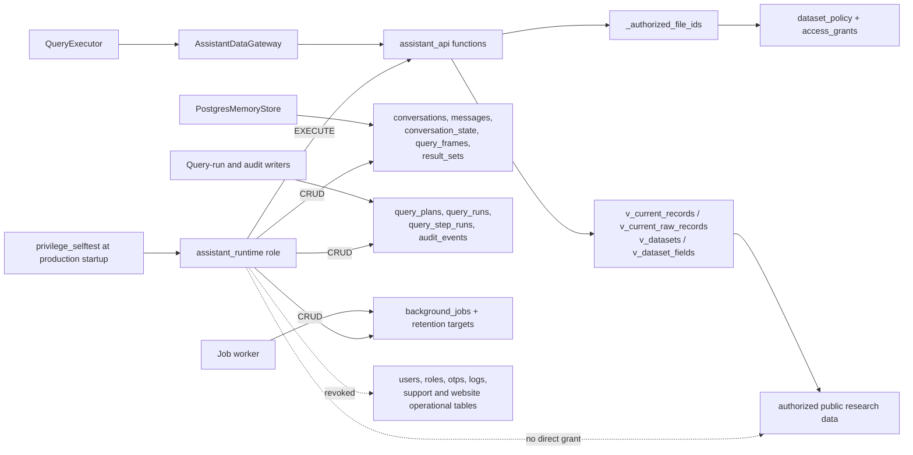

Data-gateway functions cover catalog loading, scoped counts, per-file counts,
grouping (one or two dimensions), statistics, duplicates, completeness, interval
rows/statistics, sorted/paginated/windowed lists, random samples, retrieval
candidates, evidence/raw-field reads, source-ID reads, and query-run persistence.

## 7. Realtime voice flow and barge-in

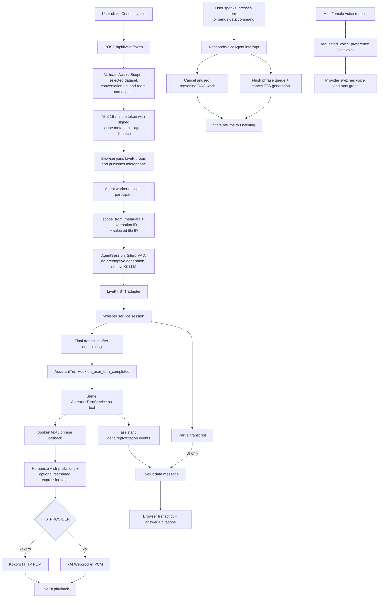

Voice state machine: `Disconnected -> Connecting -> Ready -> Listening -> User
speaking -> Processing -> Assistant speaking`, with `Interrupted`, `Reconnecting`,
and `Error` transitions protecting invalid state changes.

## 8. Local Whisper service

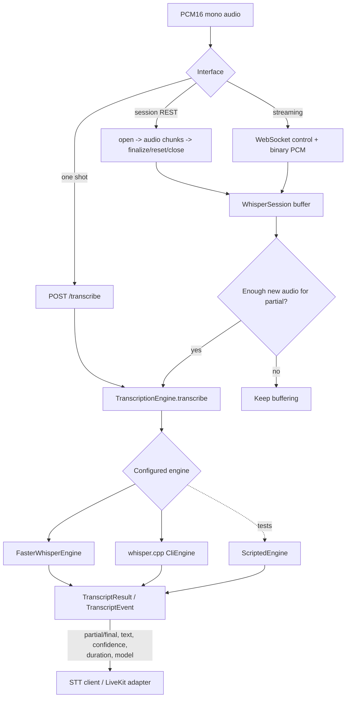

The service enforces a concurrent-session cap, expires idle sessions, buffers
audio per session, generates partials at an interval, and resets the session after
a final turn.

## 9. Memory, observability, and operations

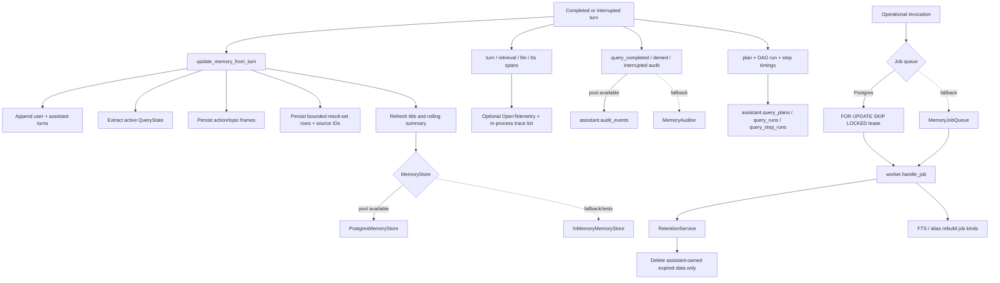

## 10. Runtime endpoints and their functions

| Endpoint | Main function | Purpose |
|---|---|---|
| `GET /health` | `health` | Liveness and configured auth/reasoning status. |
| `GET /ready` | `readiness` | Concurrent checks of PostgreSQL, Whisper, LiveKit, and reasoning configuration. |
| `POST /api/auth/login` | `login` | Standalone credential check and session-cookie creation. |
| `POST /api/auth/session` | `exchange_website_session` | Exchange a website bearer token for an assistant cookie. |
| `GET /api/auth/session` | `browser_session` | Restore or clear the browser session. |
| `GET /api/auth/me` | `me` | Return and refresh the current scope. |
| `POST /api/auth/logout` | `logout` | Clear the assistant cookie. |
| `GET /api/assistant/datasets` | `list_datasets` | Return authorized datasets, fields, operations, and starter prompts. |
| `GET /api/assistant/conversations` | `list_conversations` | List principal-owned conversation summaries. |
| `GET /api/assistant/conversations/{id}` | `get_conversation` | Load one principal-owned conversation. |
| `POST /api/assistant/query` | `query` / `_stream_query` | Run the shared core synchronously or as SSE with cancellation. |
| `POST /api/livekit/token` | `create_token` | Validate dataset/conversation scope and mint a namespaced room token. |
| `POST /api/voice/speech` | `synthesize_speech` | Authenticated PCM speech stream for the terminal client. |

## 11. Block/function responsibility catalog

| Block | Primary classes and functions | Runtime responsibility |
|---|---|---|
| App bootstrap | `create_app`, `lifespan`, `init_pool`, `close_pool`, `validate_production_settings` | Configure middleware/routes, database lifecycle, and production fail-closed checks. |
| Web UI | `HomePage`, `restoreSession`, `sendQuestion`, `applyVoiceMessage`, `connectVoiceSession`, `ChatMessage`, `StructuredListResult` | Manage auth, dataset-scoped conversations, SSE rendering, voice state, rows, and citations. |
| Web API client | `authorizedFetch`, `login`, `fetchSession`, `fetchDatasets`, `fetchConversations`, `fetchConversation`, `streamQuery`, `parseSseBlock` | Cookie-authenticated HTTP and typed SSE consumption. |
| Browser voice | `connectVoice`, `requestedVoicePreference`, `waitForVoiceInput`, `startLevelMeter`, `VoiceBar` | LiveKit connection, microphone, audio attachment, data commands, waveform, and controls. |
| Auth | `AuthAdapter`, `build_auth_adapter`, `StandaloneJwtAuthAdapter`, `WebsiteAuthAdapter`, `get_access_scope` | Convert either identity source into immutable `AccessScope`; enforce cookie-origin checks. |
| Scope/token security | `AccessScope.allows_file`, `narrow`, `fingerprint`, `assigned_room_name`, `mint_livekit_token`, `scope_from_metadata` | Preserve least privilege through HTTP, planning, database calls, and voice rooms. |
| Assistant API | `_gateway`, `_turn_service`, `query`, `_stream_query`, `_as_sse`, `_serialize_turn` | Select production/fallback dependencies and expose progress/result events. |
| Turn orchestration | `AssistantTurnService.answer`, `_answer`, `_answer_fan_out`, `_run_plan`, `_direct_reply`, `_answer_reference`, `_answer_ordinal`, `_synthesize`, `_persist` | Dataset routing, planner invocation, execution, grounded answer production, and persistence. |
| Input/conversation planning | `normalize_user_turn`, `ConversationContext`, `trusted_fast_turn`, `parse_deterministic`, `parse_schema_query`, `SemanticCompiler.compile`, `apply_trusted_overrides` | Convert a final utterance and prior frames into trusted structured intent. |
| Plan construction/security | `validate_turn_plan`, `decide_final_response`, `build_query_plan`, `expand_plan_values`, `validate_query_plan`, `plan_covers_question` | Build only allow-listed, bounded, scoped DAGs from structured actions. |
| Plan models | `TurnPlan` action models, `QueryPlan`, `PlanScope`, `PlanStep`, `Predicate`, `PlanOp`, `FilterOperator` | Typed contracts between interpretation, validation, compilation, and execution. |
| Execution | `QueryExecutor.execute`, `_run_step`, `_reduce`, `DagScheduler.run`, `_run_one`, `_cancel_group`, `with_timeout`, `ResourceGate`, `Singleflight`, `CancellationToken` | Run independent plan steps concurrently with limits, timeouts, deduplication, and cancellation. |
| Filtering/projection/formatting | `predicate_matches`, `matches_predicate_tree`, `apply_predicates`, `public_projected_row`, `format_deterministic_answer`, `format_spoken_answer` | Apply typed predicates in fallback mode and expose only catalog-approved output. |
| Data gateway | `DataGateway`, `AssistantDataGateway`, `MemoryDataGateway` and their count/group/stats/list/sample/retrieve/evidence methods | Keep execution independent of PostgreSQL while enforcing scoped production calls. |
| Retrieval | `score_exact`, `score_fts`, `score_fuzzy`, `resolve_entity`, `dedupe_hits`, `rank_hits`, `HybridRetriever.retrieve`, `build_evidence_packet` | Score and merge search hits and construct bounded grounded evidence. |
| Reasoning | `get_reasoning_provider`, `XAIReasoningProvider.structured_output`, `SemanticCompiler.compile`, `_synthesize`, `validate_synthesis` | Structured intent and optional evidence-grounded prose; never database access. |
| Conversation memory | `default_memory_store`, `InMemoryMemoryStore`, `PostgresMemoryStore`, `update_memory_from_turn`, `extract_query_state`, `resolve_followup`, `resolve_listed_ordinal` | Principal isolation, durable shared text/voice history, frames, paging, and row references. |
| Realtime agent | `_agent_entry`, `ResearchVoiceAgent.handle_final_transcript`, `AssistantTurnHook.on_user_turn_completed`, `handle_voice_preference`, `interrupt`, `VoiceStateMachine.transition` | Bridge LiveKit final turns to the shared core and publish replies/citations/state. |
| STT adapter/service | `WhisperCppSTTProvider`, `create_livekit_stt`, `WhisperService`, `WhisperSession`, `build_engine`, engine `transcribe` methods | Convert PCM to partial/final transcripts locally. |
| TTS | `get_tts_provider`, `SpeechSession`, `PhraseBuffer`, `PhraseQueue`, `create_livekit_tts`, `XAITTSProvider`, `KokoroTTSProvider`, `humanize_for_speech`, expression helpers | Produce bounded, citation-free streamed speech with cancellation and voice switching. |
| Observability | `Tracer.span`, `default_auditor`, `PostgresAuditor.record`, `save_query_run` | Capture safe spans, authorization outcomes, and durable DAG performance. |
| Background jobs | `PostgresJobQueue`, `MemoryJobQueue`, `run_once`, `handle_job`, `RetentionService` | Lease, retry, complete, and safely purge/rebuild assistant-owned operational data. |
| Database lifecycle | `apply_migrations`, `assert_runtime_isolation` | Apply ordered SQL migrations and verify the runtime role cannot cross the privilege boundary. |
| Terminal client | `AssistantClient`, `WhisperClient`, `Microphone`, `BackendSpeaker`, `Speaker`, `run_text`, `run_voice`, `run_wav`, `_handle_utterance` | Alternate authenticated text/microphone/WAV client with local or backend speech. |

## 12. Review notes: active, fallback, and dormant paths

- Active production query path: API/voice -> `AssistantTurnService` -> planning router ->
  validated `QueryPlan` -> `QueryExecutor`/DAG -> `AssistantDataGateway` ->
  `assistant_api` -> formatting or grounded synthesis -> memory/audit.
- Development fallback: if the PostgreSQL pool is unavailable, API and voice may
  use `MemoryDataGateway`; memory and audit also have in-process fallbacks.
- `HybridRetriever` is tested but not wired into `QueryExecutor`; executor search
  steps implement equivalent direct exact/FTS/fuzzy branches.
- `vector_search.score_vector` is a deliberate empty stub; semantic/vector search
  is not an active runtime capability.
- `LLMTurnInterpreter`, `ConstrainedPlanner`, and
  `AssistantTurnService._reasoned_plan_and_answer` remain compatibility/legacy
  code. The current router uses `SemanticCompiler` for the model-backed planning
  path.
- The SQL schema includes forward-looking tables (feedback, voice sessions,
  attachments, citations) beyond the tables written by the current request path.
- The background worker handles retention and recognizes rebuild job kinds, but it
  is a one-shot operational command unless an external scheduler invokes it.

For the exhaustive source-symbol list (including private helpers), see
`docs/system-function-inventory.md`.
